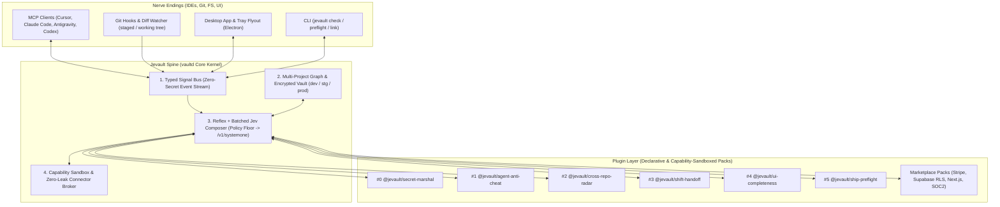
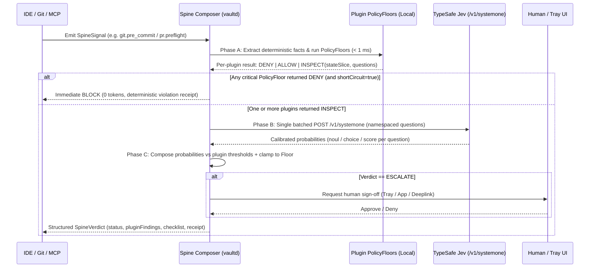

# Jevault — Nervous System & Plugin Architecture Design Spec

- **Date:** 2026-11-07
- **Supersedes / Extends:** [2026-10-31-metavault-design.md](file:///c:/Users/Mowreez.DESKTOP-D1GHS6J/metavault/docs/superpowers/specs/2026-10-31-metavault-design.md)
- **Status:** Draft for review (no production code modified until approved)

> [!IMPORTANT]
> **Core Architectural Law:** Keep the `vaultd` Spine tiny and verifiable; build every capability—including secret marshaling, agent anti-cheat, cross-repo contract tracking, IDE shift handoff, UI completeness, and ship preflight—as a **Policy + Jev Plugin** running on that Spine.

---

## 1. Executive Summary & Thesis

MetaVault OSS proved a foundational security and quality thesis in [thesis-review.md](file:///c:/Users/Mowreez.DESKTOP-D1GHS6J/metavault/docs/research/thesis-review.md):

1. **Deterministic Rules Alone Are Brittle:** Static patterns enforce hard boundaries in `< 1 ms` with zero false negatives on structural invariants, yet miss paraphrased or contextual risk (`42.9%` recall on held-out nuanced cases).
2. **Models Alone Have Blind Spots & Cause Fatigue:** Prompted chat LLMs hallucinate prose nitpicks, drift under adversarial framing, and burn tokens/latency.
3. **`Policies + Jev` = Calibrated Precision Without Fatigue:** Combining a deterministic **Policy Floor** ([`policy.ts`](file:///c:/Users/Mowreez.DESKTOP-D1GHS6J/metavault/packages/core/src/policy.ts)) with **TypeSafe Jev System One** ([`jev.ts`](file:///c:/Users/Mowreez.DESKTOP-D1GHS6J/metavault/packages/brain/src/jev.ts)) pairs `< 1 ms` unbypassable invariants with parallel, zero-prose, calibrated probability signals (`noul`, `choice`, `score` at `$0.042/MTok`).

**Jevault** generalizes this engine from *"Can this agent use this API key?"* to ***"Is this workspace healthy, coherent across repos, honest in its tests, and ready to ship?"***

Because `vaultd` already runs locally across **every IDE and coding agent** (`Cursor`, `Claude Code`, `Antigravity`, `VS Code`, `Codex`, `CLI`) and holds **multi-project environment secrets** without ever leaking them into context, Jevault is uniquely positioned to act as the developer's **Local Coding Nervous System**.

---

## 2. High-Level Architecture: The Spine & The Plugins



### Why Biological Framing Matches the Code

| Biological Role | Jevault Component | Existing Anchor | Runtime Profile |
|---|---|---|---|
| **Spinal Reflex** | Deterministic `PolicyFloor` | [`packages/core/src/policy.ts`](file:///c:/Users/Mowreez.DESKTOP-D1GHS6J/metavault/packages/core/src/policy.ts) | `< 1 ms`, 0 tokens, unbypassable, 100% deterministic |
| **Cortical Signal** | Batched `Jev` Questions (`noul` / `choice` / `score`) | [`packages/brain/src/jev.ts`](file:///c:/Users/Mowreez.DESKTOP-D1GHS6J/metavault/packages/brain/src/jev.ts) | Single parallel HTTP call, calibrated `0.00–1.00` probabilities, zero prose |
| **Nerve Spine** | Local Daemon + Multi-Project Graph + Signal Bus | [`packages/daemon/src/live-events.ts`](file:///c:/Users/Mowreez.DESKTOP-D1GHS6J/metavault/packages/daemon/src/live-events.ts) | Always-on localhost control plane (`127.0.0.1:7077`) |
| **Motor Execution** | Zero-Leak Credential & Verification Broker | [`packages/connectors/src/http.ts`](file:///c:/Users/Mowreez.DESKTOP-D1GHS6J/metavault/packages/connectors/src/http.ts) | Plaintext secrets exist only in `vaultd` memory during one call |
| **Nerve Endings** | Cross-IDE MCP Server, Git Hooks, Tray App | [`packages/mcp/src/server.ts`](file:///c:/Users/Mowreez.DESKTOP-D1GHS6J/metavault/packages/mcp/src/server.ts) | Shared awareness across every agent and terminal |

---

## 3. Core Spine Primitives (The Only 4 Things in Core)

### 3.1 Primitive 1: Multi-Project Workspace Graph & Scoped Vault

Extend SQLite storage in [`packages/core/src/storage.ts`](file:///c:/Users/Mowreez.DESKTOP-D1GHS6J/metavault/packages/core/src/storage.ts) with backward-compatible migrations (existing unscoped credentials default to `project_id = 'global'`, `env = 'all'`):

1. **`projects`**
   - `id` (`TEXT PRIMARY KEY`), `slug` (`TEXT UNIQUE`), `name` (`TEXT`), `root_path` (`TEXT UNIQUE`), `stack_tags_json` (`TEXT` — e.g. `["nextjs","effect","postgres","stripe"]`), `created_at` (`TEXT`).
2. **`project_environments`**
   - `project_id` (`TEXT`), `env` (`'dev' | 'staging' | 'prod' | 'preview'`), `require_approval_for_reads` (`INTEGER`), `allow_agent_writes` (`INTEGER`, default `0` for `prod`).
3. **`project_links`** *(powers Cross-Repo Radar & Shared Secret Sync)*
   - `id` (`TEXT PRIMARY KEY`), `source_project_id` (`TEXT`), `target_project_id` (`TEXT`), `kind` (`'api-consumer' | 'shared-env' | 'shared-schema' | 'monorepo-pkg'`), `contract_paths_json` (`TEXT`).
4. **Scoped Credentials (`credentials` table extension)**
   - Add `project_id TEXT NOT NULL DEFAULT 'global'` and `env TEXT NOT NULL DEFAULT 'all'`.
   - Composite lookup resolves `(project_id, env, alias)` -> `(project_id, 'all', alias)` -> `('global', 'all', alias)`.
   - **Required Key Manifest (`project_env_requirements`):** Tracks expected `.env` / vault aliases per project so Jevault immediately detects `dev` vs `staging` vs `prod` drift.
5. **`project_plugins`**
   - `project_id` (`TEXT`), `plugin_id` (`TEXT`), `enabled` (`INTEGER`), `config_json` (`TEXT` — threshold overrides, ignored globs).

### 3.2 Primitive 2: Typed Zero-Secret Signal Bus

Evolve [`VaultLiveEvent`](file:///c:/Users/Mowreez.DESKTOP-D1GHS6J/metavault/packages/daemon/src/live-events.ts#L4-L24) into `SpineSignal`. Every signal carries `signalId`, `ts`, `projectId`, `agentId?`, `ide?`, and metadata-only `facts` (**never** secret values, raw `.env` contents, or bearer tokens):

| Signal Type | Emitter | When It Fires | Execution Mode |
|---|---|---|---|
| `secret.requested` | MCP / Daemon | Agent calls `request_capability` | **Blocking Gate** |
| `diff.mutated` | FS / Git Watcher / MCP | Working-tree or staged diff settles (debounced) | **Async Pulse** |
| `git.pre_commit` | Git Hook / CLI / MCP | Before commit creation | **Blocking Gate** |
| `contract.changed` | Diff Extractor | Exported API schema, route type, or `.env` key changes | **Cross-Project Broadcast** |
| `agent.session_changed` | MCP Server | New IDE/agent connects or requests handoff | **Context Injection** |
| `pr.preflight` | MCP `run_preflight` / CLI | Developer or agent checks ship readiness | **Blocking / Receipt Gate** |
| `postmortem.recorded` | MCP / UI / CLI | User records a bug or rejected shortcut to immunize | **Policy Synthesis** |

### 3.3 Primitive 3: Reflex + Batched Jev Composer

When a `SpineSignal` fires and `N` active plugins subscribe to it, the Spine executes a strict **3-phase pipeline** so latency and token spend stay near-constant regardless of plugin count:



> [!NOTE]
> **Fail-Closed & Provider Agnosticism:** Update [`WardenProvider`](file:///c:/Users/Mowreez.DESKTOP-D1GHS6J/metavault/packages/core/src/settings.ts#L28) to `"none" | "jev" | "meta-api" | "local" | "bft"` with `"jev"` (`jev-1.14.0` via [`jev.ts`](file:///c:/Users/Mowreez.DESKTOP-D1GHS6J/metavault/packages/brain/src/jev.ts)) as the primary decision model. If `Jev` is offline, unreachable, or unconfigured, Phase A (`PolicyFloor`) still enforces every hard invariant and any `INSPECT` item with `failClosed: true` escalates to the human.

### 3.4 Primitive 4: Capability Sandbox & Zero-Leak Verification

Plugins never receive raw credentials. If a plugin (such as `@jevault/ship-preflight` or `@jevault/stripe-pack`) needs to verify live external state—for example checking whether a Stripe `price_...` ID referenced in code exists in the `prod` Stripe account—it requests a read-only **Verification Probe** through [`ConnectorService`](file:///c:/Users/Mowreez.DESKTOP-D1GHS6J/metavault/packages/core/src/connector.ts#L13-L22), returning only a boolean/metadata summary (`{ exists: true, currency: "usd", livemode: true }`).

---

## 4. Plugin Architecture & Manifest Spec

To keep the Marketplace fast, auditable, and safe from supply-chain attacks, Jevault separates plugins into two tiers:

- **Tier 1 — Declarative Capsule (`jev-plugin.json`):** Pure data + built-in Spine fact extractors + Policy predicates + Jev questions + Eval suite. **Zero arbitrary JS execution.** Covers ~90% of community plugins.
- **Tier 2 — Capability-Sandboxed Effect Pack (`@jevault/*` & Verified Packs):** Typed Effect-TS modules implementing `JevaultPlugin`, restricted to read-only workspace AST/diff views and capability-gated [`Connector`](file:///c:/Users/Mowreez.DESKTOP-D1GHS6J/metavault/packages/core/src/connector.ts) probes.

### 4.1 Core Plugin Interfaces (Effect Schema)

```typescript
export type JevQuestionSpec =
  | { readonly type: "noul"; readonly instructions: string }
  | { readonly type: "choice"; readonly instructions: string; readonly criteria: Record<string, string> }
  | { readonly type: "score"; readonly instructions: string; readonly min?: number; readonly max?: number };

export type FloorOutcome =
  | { readonly tag: "allow"; readonly summary: string }
  | { readonly tag: "deny"; readonly code: string; readonly summary: string; readonly locations?: readonly CodeLocation[] }
  | { readonly tag: "inspect"; readonly stateSlice: Record<string, unknown> };

export interface ThresholdRule {
  readonly questionKey: string;
  // For "noul" / "score": probability >= blockAt blocks; >= warnAt warns/escalates.
  // For "choice": maps chosen label + probability threshold to action.
  readonly blockAt?: number;       // e.g. 0.70
  readonly escalateAt?: number;    // e.g. 0.50
  readonly warnAt?: number;        // e.g. 0.40
  readonly failClosed?: boolean;   // If Jev is offline, treat inspect as escalate/block
}

export interface JevaultPluginManifest {
  readonly id: string;                       // e.g. "@jevault/agent-anti-cheat"
  readonly version: string;
  readonly name: string;
  readonly subscribesTo: readonly SpineSignalType[];
  readonly extractors: readonly BuiltinExtractorSpec[];
  readonly jevQuestions: Record<string, JevQuestionSpec>;
  readonly thresholds: readonly ThresholdRule[];
  readonly checklistTemplates?: readonly DynamicChecklistSpec[];
  readonly requiredConnectorCapabilities?: readonly { aliasPattern: string; scope: string }[];
}
```

### 4.2 Proof-Carrying Marketplace ("Eval Badges")

Extending [`packages/brain/eval/run-eval.ts`](file:///c:/Users/Mowreez.DESKTOP-D1GHS6J/metavault/packages/brain/eval/run-eval.ts), **every plugin must include an `eval/scenarios.json` file** containing positive (must-catch) and hard-benign (must-not-nag) cases.
- Running `jevault plugin eval <plugin>` executes the plugin's `PolicyFloor + Jev` pipeline against its scenarios and outputs:
  - **Floor Recall** (deterministic catches)
  - **Combined Recall (`Floor + Jev`)**
  - **False-Positive Rate (Interrupt Fatigue Score)**
  - **Median Token Cost (`MTok`) & Latency (`ms`)**
- Marketplace listings display these measured numbers directly—eliminating noisy "slop" rule packs.

---

## 5. First-Party Core Plugins (Dogfooding Everything on the Spine)

### Plugin `#0`: `@jevault/secret-marshal` *(Existing Core Ported)*
- **Subscribes to:** `secret.requested`
- **Spinal Reflex:** Alias existence, [`PolicyConfig`](file:///c:/Users/Mowreez.DESKTOP-D1GHS6J/metavault/packages/core/src/policy.ts#L4-L18) scope ceilings, writes always require human approval, `prod` environment ceiling rules, [`AgentVelocityTracker`](file:///c:/Users/Mowreez.DESKTOP-D1GHS6J/metavault/packages/core/src/policy.ts#L45-L50) circuit breaker.
- **Jev Questions:** Exact 5 questions from [`jev.ts`](file:///c:/Users/Mowreez.DESKTOP-D1GHS6J/metavault/packages/brain/src/jev.ts#L173-L202) (`risk`, `needs_approval`, `exfil`, `injection`, `mutating`).
- **Guarantee:** 100% backward-compatible with all existing tests and [`test/canary.test.ts`](file:///c:/Users/Mowreez.DESKTOP-D1GHS6J/metavault/test/canary.test.ts).

### Plugin `#1`: `@jevault/agent-anti-cheat` *(Agent Integrity Guard)*
- **Problem Solved:** Coding agents stuck on a failing task routinely delete assertions, add `.skip`, sprinkle `as any` / `@ts-ignore` / `eslint-disable`, hardcode mock payloads in production code, or weaken auth/CORS middlewares to `"*"` just to turn tests green.
- **Subscribes to:** `diff.mutated`, `git.pre_commit`, `pr.preflight`
- **Spinal Reflex (`PolicyFloor`):**
  - Hard-blocks net assertion deletion in existing test files unless an explicit human override grant exists.
  - Hard-blocks `.only` / `.skip` in staged test files and `@ts-ignore` / `@ts-expect-error` without reason in protected globs (`auth/**`, `billing/**`, `crypto/**`, `policy/**`).
  - Hard-blocks CORS `"*"` or disabled CSRF/signature verification flags in route handlers.
- **Jev Questions (`noul`):**
  - `test_intent_weakened`: *"Does this diff weaken, tautologize, or bypass the original behavior verified by the test rather than fixing the underlying bug?"* (`blockAt: 0.70`)
  - `mock_or_stub_leak`: *"Does production (non-test) code introduce hardcoded fake data, stubbed success returns, or swallowed errors to simulate completion?"* (`blockAt: 0.70`)
  - `security_guard_bypass`: *"Does this diff relax authentication, authorization, validation, or rate-limiting logic as a workaround?"* (`blockAt: 0.65`, `failClosed: true`)

### Plugin `#2`: `@jevault/cross-repo-radar` *(Multi-Project Nervous System)*
- **Problem Solved:** Changing an API response field, Effect/Zod schema, webhook payload, or required `.env` variable in `api` silently breaks `web`, `mobile`, or `worker` repos sitting on the same machine.
- **Subscribes to:** `diff.mutated`, `contract.changed`, `pr.preflight`
- **Spinal Reflex (`PolicyFloor`):**
  - Resolves `project_links` in the Multi-Project Graph.
  - Compares exported route/schema signatures, OpenAPI/GraphQL/RPC definitions, and `process.env` / vault alias references between source and linked target repos.
  - Flags exact missing env keys or removed fields referenced in consumer repos.
- **Jev Questions (`noul`):**
  - `breaking_consumer_contract`: *"Given the producer diff in Project A and the consumer usage snippet in Project B, will Project B fail at build time or runtime without a coordinated update?"* (`blockAt: 0.75`, `warnAt: 0.45`)
  - `semantic_behavior_drift`: *"Even though types still compile, did units, pagination semantics, nullability, or error status codes change in a way that breaks the linked consumer?"* (`warnAt: 0.50`)

### Plugin `#3`: `@jevault/shift-handoff` *(Cross-IDE Continuity & Flight Recorder)*
- **Problem Solved:** Developers switch between Claude Code, Cursor, Antigravity, and Codex mid-feature (due to rate limits, context bloat, or task type). Every switch normally loses architectural constraints, failed approaches, and pending ship blockers.
- **Subscribes to:** `agent.session_changed`, `diff.mutated`, `git.pre_commit`, `audit.appended`
- **Spinal Reflex (`PolicyFloor`):**
  - Maintains a compact, zero-secret per-branch **Flight Ledger** in SQLite: touched files, active plugins' unresolved warnings/blocks, capability grants used, and explicit shift notes.
- **Jev Questions (`noul` / `choice`):**
  - `handoff_readiness`: Evaluates whether uncommitted work is mid-refactor or contains half-wired states so the incoming agent gets an exact structured briefing.
- **MCP Surface:** Exposes `jevault://nervous-system/handoff` automatically on first turn so Agent B immediately picks up where Agent A stopped—without repeating mistakes.

### Plugin `#4`: `@jevault/ui-completeness` *(5-State Component Contract)*
- **Problem Solved:** Agents and developers ship "happy-path" components that break on slow networks, empty datasets, 500 errors, or rapid double-clicks.
- **Subscribes to:** `diff.mutated`, `pr.preflight`
- **Spinal Reflex (`PolicyFloor`):**
  - AST-scans changed UI components (`*.tsx`, `*.jsx`, `*.vue`, `*.svelte`) containing async hooks/actions (`useQuery`, `useMutation`, `useActionState`, `fetch`) and checks branch coverage for pending/error/empty states and button `disabled` binding during mutations.
- **Jev Questions (`noul`):**
  - `handles_loading_cleanly`: *"Does this stateful component render an explicit loading/skeleton state without layout thrash or unprotected double-submission?"*
  - `handles_empty_state`: *"When the fetched collection or record is legitimately empty, does the component render a meaningful zero-state rather than blank space or crashing?"*
  - `handles_error_actionably`: *"When the query or mutation fails, is the error surfaced safely to the user (with retry/fallback) instead of silently failing or crashing the tree?"*
  - `edge_overflow_safe`: *"Are long strings, zero values (`0` vs `null`), and missing optional fields rendered safely?"*

### Plugin `#5`: `@jevault/ship-preflight` *(Vault Parity + Dynamic PR Checklist + Receipt)*
- **Problem Solved:** Last-mile production incidents caused by missing `prod` secrets, destructive DB migrations, unguarded public endpoints, or rubber-stamped static PR templates.
- **Subscribes to:** `pr.preflight`, `git.pre_push`
- **Spinal Reflex (`PolicyFloor`):**
  - **Multi-Env Vault Parity:** Scans code for env/alias usages and verifies presence + scope ceiling compatibility across `dev`, `staging`, and `prod` in the Jevault store.
  - **Migration Gate:** Flags `DROP TABLE`, `DROP COLUMN`, `ALTER COLUMN ... NOT NULL` without default, or missing down/rollback strategy.
  - **Dynamic Checklist Synthesis:** Generates diff-specific checklist items based on touched paths (`billing/**`, `migrations/**`, `api/**`, `auth/**`).
- **Jev Questions (`noul`):**
  - `rollback_safe`: *"Can this change be rolled back safely if deployed alongside the current production database schema?"* (`escalateAt: 0.50`)
  - `public_surface_protected`: *"Do newly added or modified network endpoints enforce authentication, input schema validation, and rate limiting?"* (`blockAt: 0.70`)
  - `sensitive_log_leak`: *"Does any added logging, telemetry, or error response risk leaking PII, tokens, or raw request credentials?"* (`blockAt: 0.65`)
- **Output:** Produces a deterministic **Ship Confidence Receipt** (markdown + JSON digest signed by `vaultd` timestamp & commit SHA) ready to paste or attach to the PR.

### Bonus Loop: `@jevault/postmortem-immunizer`
- Exposes `record_postmortem({ summary, badDiffOrCommit?, invariant })`.
- Generates a project-local declarative rule + `Jev` question + 2 synthetic test scenarios (1 bad, 1 benign), verifies them via the local eval runner, and activates the rule across the workspace.

---

## 6. MCP, CLI & Desktop UI Evolution

### 6.1 MCP Additions ([`packages/mcp/src/server.ts`](file:///c:/Users/Mowreez.DESKTOP-D1GHS6J/metavault/packages/mcp/src/server.ts))
All 8 existing secret/enrollment/registration tools remain untouched. Add 4 Nervous-System tools and 3 resources:

- **Tools:**
  1. `check_pulse({ projectSlug?, paths? })` — Runs fast `diff.mutated` reflex + batched Jev check; returns structured findings so agents self-correct *before* finishing their turn.
  2. `run_preflight({ projectSlug?, targetEnv?: "staging" | "prod" })` — Runs full ship-readiness, vault parity, UI completeness, cross-repo radar, and returns the dynamic PR checklist + Ship Receipt.
  3. `handoff_context({ action: "read" | "checkpoint", note? })` — Reads or checkpoints the cross-IDE Shift Handoff ledger.
  4. `immunize_bug({ title, rootCause, fileGlob? })` — Creates a local project guardrail from a postmortem or user correction.
- **Resources:**
  - `jevault://nervous-system/pulse` — Live workspace health & active blocks.
  - `jevault://nervous-system/handoff` — Cross-agent session continuity brief.
  - `jevault://project/contracts` — Linked repo graph & shared env/contract summary.

### 6.2 CLI Commands ([`packages/cli`](file:///c:/Users/Mowreez.DESKTOP-D1GHS6J/metavault/packages/cli))
- `jevault project init [--slug web] [--env dev,staging,prod]`
- `jevault project link <source> <target> --kind api-consumer`
- `jevault check` *(fast local pulse — suitable for `pre-commit`)*
- `jevault preflight [--env prod]` *(full ship gate + PR checklist markdown output)*
- `jevault plugin list | enable | disable | eval`

### 6.3 Desktop App (`packages/app`)
- Remains a thin, zero-secret Electron window projecting whitelisted daemon payloads (Effect imports stay lint-banned in renderer).
- Adds **Projects & Env Matrix** view (shows `dev` / `staging` / `prod` secret parity at a glance—aliases only, never values), **Pulse / Preflight** view, and **Plugins** tab with live Recall/FPR eval badges.

---

## 7. Security & Privacy Invariants

> [!CAUTION]
> Expanding Jevault into code and workspace intelligence **must never weaken** the zero-context secret invariants established in [SECURITY.md](file:///c:/Users/Mowreez.DESKTOP-D1GHS6J/metavault/SECURITY.md).

1. **Extended Canary Invariant ([`test/canary.test.ts`](file:///c:/Users/Mowreez.DESKTOP-D1GHS6J/metavault/test/canary.test.ts)):** The build-failing canary grep test is extended to scan `SpineSignal` payloads, plugin `stateSlice` objects sent to TypeSafe `Jev`, SQLite Shift Handoff rows, MCP `check_pulse` / `run_preflight` responses, and Ship Receipts. Any secret substring hit fails CI.
2. **Diff Secret Scrubbing at Ingestion:** Before any git diff or AST snippet enters a `SpineSignal` or `Jev` `stateSlice`, high-entropy strings, `.env` values, and known vault ciphertexts/fingerprints are redacted locally in `vaultd`.
3. **One-Way Authority Clamping:** Neither `Jev` nor any plugin can widen a vault capability grant or override another plugin's `PolicyFloor` `deny`. Stricter verdict always wins.
4. **Metadata & Diff Privacy Controls:** Per-project setting `allowCloudCodeSnippets: boolean` (default `false` for strict mode: sends only structural AST/diff metadata counts & symbol names to cloud `Jev`, or routes snippet inspection exclusively to the user's local endpoint).

---

## 8. Phased Implementation Plan

| Phase | Scope | Key Deliverables & Verification |
|---|---|---|
| **Phase 1: Jev Warden + Multi-Project Store** | [`packages/core`](file:///c:/Users/Mowreez.DESKTOP-D1GHS6J/metavault/packages/core), [`packages/brain`](file:///c:/Users/Mowreez.DESKTOP-D1GHS6J/metavault/packages/brain) | Wire `"jev"` into `WardenProvider` (`settings.ts` + `brain.ts`); add `projects`, `project_environments`, `project_links`, and scoped credentials to `storage.ts` with non-destructive SQLite migration + unit tests. |
| **Phase 2: The Spine & Plugin `#0`** | `packages/spine` (or `packages/core` + `packages/daemon`) | Implement `SpineSignal` bus, `JevaultPlugin` schema, Phase A (`PolicyFloor`) + Phase B (Batched `/v1/systemone` composer), and port `@jevault/secret-marshal` as Plugin `#0` with all 520+ existing tests green. |
| **Phase 3: Core Companion Plugins (`#1`, `#2`, `#3`)** | `packages/plugins/*`, [`packages/mcp`](file:///c:/Users/Mowreez.DESKTOP-D1GHS6J/metavault/packages/mcp) | Ship `@jevault/agent-anti-cheat`, `@jevault/cross-repo-radar`, and `@jevault/shift-handoff` + MCP `check_pulse` and `jevault://nervous-system/handoff` + held-out eval suites. |
| **Phase 4: Ship Readiness, UI Completeness & App UI** | `packages/plugins/*`, [`packages/cli`](file:///c:/Users/Mowreez.DESKTOP-D1GHS6J/metavault/packages/cli), [`packages/app`](file:///c:/Users/Mowreez.DESKTOP-D1GHS6J/metavault/packages/app) | Ship `@jevault/ui-completeness`, `@jevault/ship-preflight` (Env Parity + Dynamic PR Checklist + Ship Receipt), `jevault preflight` CLI, Plugin Eval CLI, and Desktop App views. |

---

## 9. Open Decisions for Review

1. **Package Layout:** Should the Spine live inside a new `packages/spine` + `packages/plugins` workspace pair, or inside `packages/core` (`spine.ts`) + `packages/plugins` to keep package count minimal? *(Recommended: keep types/floors in `packages/core`, batched Jev execution in `packages/brain`, and plugins in `packages/plugins`.)*
2. **Code Snippet Privacy Default for Cloud `Jev`:** When sending `stateSlice` to `https://api.typesafe.ai/v1/systemone`, should default mode send **compact diff hunks** (redacted for secrets) for higher semantic accuracy, or **structural AST/symbol summaries only** unless opted in per project?
3. **Rebrand Timing (`metavault` -> `jevault`):** Keep dual CLI/env/protocol aliases (`jevault` + `metavault`, `jevault://` + `metavault://`) during Phase 1–2 so existing IDE MCP configs don't break, or cut over cleanly now?
